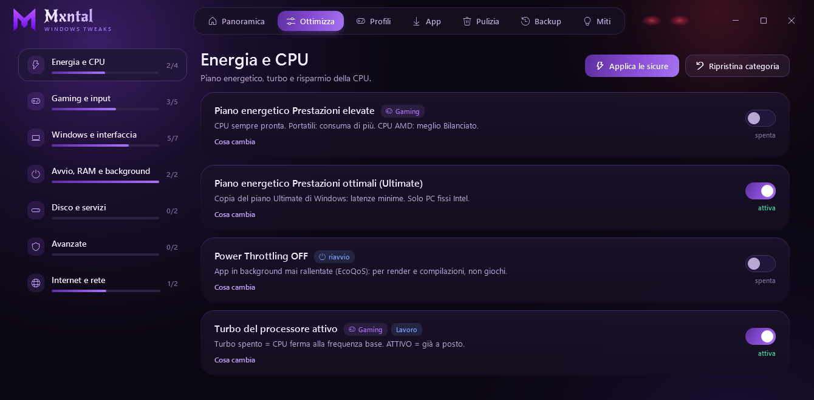

<h1 align="center">Mxntal</h1>

<strong>Lavora nell'ombra. Tu giochi.</strong> · Il travaille dans l'ombre. Toi, tu joues.

  
  

<a href="README.md">English</a> · <a href="README.it.md">Italiano</a> · <a href="README.es.md">Español</a> · <strong>Français</strong>

Mxntal optimise Windows 10 et 11 sans boîte noire : chaque modification a une raison écrite, une
sauvegarde de la valeur précédente et une restauration en un clic. C'est un seul fichier,
`MxntalTweaks.bat`, avec une interface graphique et, pour ceux qui les préfèrent, les menus classiques en
console. Rien à installer. L'interface est en italien.

## Télécharger et lancer

1. Téléchargez la dernière version : **[MxntalTweaks.bat](https://github.com/Gio-V5/mxntal/releases/latest/download/MxntalTweaks.bat)**
   (environ 640 Ko).
2. Double-clic : Windows demande les droits d'administrateur et la fenêtre s'ouvre. Si vous refusez,
   Mxntal se ferme sans rien changer.
3. Au premier lancement, Windows peut avertir que l'éditeur est inconnu : c'est le cas de tout fichier
   `.bat` téléchargé d'internet.

Prérequis : Windows 10 ou 11 avec un compte administrateur ; Windows PowerShell 5.1 (déjà dans Windows) ;
pour la page App, winget (« Programme d'installation d'application » du Microsoft Store).

## Ce qu'il fait

- **Panoramica** (vue d'ensemble) : un bilan avec un score et les choses à corriger, chacune avec le
  bouton pour le faire ; CPU, mémoire, carte graphique et disque en temps réel ; la fiche du PC.
- **Ottimizza** (optimiser) : 36 réglages en 7 catégories (énergie et CPU ; jeu et périphériques ;
  Windows et interface ; démarrage, RAM et arrière-plan ; disque et services ; internet et réseau ;
  avancés). Chaque réglage explique ce qu'il change, les réglages risqués demandent confirmation ;
  « appliquer les sûrs » et « restaurer la catégorie » font tout d'un coup.
- **Profili** : profils rapides, Gaming et Travail.
- **App** : 106 programmes courants en 10 catégories (navigateurs, jeu, périphériques, communication, multimédia, bureautique, utilitaires, sécurité, diagnostic, développement), installés avec winget depuis les paquets officiels des éditeurs. Une recherche, et ceux déjà présents sur le PC sont signalés.
- **Pulizia** (nettoyage) : fichiers inutiles (temporaires, dumps, journaux et, si vous le choisissez, la
  Corbeille), mesurés avant suppression ; applications préinstallées (43 dans la liste), retirées pour
  l'utilisateur courant et remises en un clic ; programmes lancés au démarrage de Windows.
- **Backup**, la machine à remonter le temps : chaque valeur sauvegardée avec sa restauration, les points
  de restauration de Windows, le redémarrage programmé.
- **Miti** (mythes démontés) : les tweaks célèbres que Mxntal n'applique pas, et pourquoi.

## Ce qu'il ne touche jamais

- Microsoft Store, Windows Update, Optimisation de la distribution, services Xbox, Xbox Game Bar et
  enregistrement Game DVR.
- Pas de tweaks placebo : Win32PrioritySeparation, NetworkThrottlingIndex, HPET et consorts restent
  dehors ; la page des mythes explique pourquoi.
- Les paramètres que Windows protège avec le pilote UCPD (par exemple les Widgets sur certains PC) :
  Mxntal ne le contourne pas, il explique le blocage et indique l'alternative que Windows autorise.
- Sur un PC joint à un domaine, le DNS reste celui de l'entreprise, et les réglages sensibles
  (indexation, protections de sécurité, exclusions Defender, TCP) expliquent pourquoi et demandent
  confirmation.

## Sauvegarde et restauration

- Avant chaque modification, la valeur d'origine va dans `%LOCALAPPDATA%\MxntalTweaks\Backup\originali`,
  un fichier par valeur, et reste celle d'avant Mxntal même si vous appliquez un réglage plusieurs fois.
- Chaque écriture est relue : si la valeur n'est pas celle attendue, Mxntal le dit et le réglage est
  marqué en erreur.
- Restaurer depuis la fenêtre : Backup, une valeur à la fois ou tout d'un coup ; Ottimizza, éteignez
  l'interrupteur ou « Ripristina categoria » ; Pulizia, « Rimetti le app tolte ». En console : menu 9.
- Le journal `%LOCALAPPDATA%\MxntalTweaks\MxntalTweaks.log` note la date, l'action, la valeur avant et
  après, et le résultat.
- Seul le nettoyage des fichiers est sans retour : c'est pourquoi Mxntal mesure d'abord et demande
  confirmation.

## Mises à jour

À chaque lancement, et toutes les heures tant qu'elle reste ouverte, la fenêtre vérifie s'il existe une
nouvelle version (une requête HTTPS de 1 Ko, aucune donnée envoyée) et l'installe en un clic, seulement
si elle est signée. Le bouton **Controlla aggiornamenti** vérifie tout de suite ; « Non controllare più
gli aggiornamenti » coupe la vérification automatique. Les nouveautés de chaque version sont dans le
[changelog](CHANGELOG.en.md) (en anglais).

## Console classique

| Commande | Ce qu'elle fait |
|---|---|
| `MxntalTweaks.bat /console` | les menus classiques en console, avec les droits d'administrateur |
| `MxntalTweaks.bat /dryrun` | aperçu : montre ce qui changerait, ne touche à rien et ne demande aucun droit |
| `MxntalTweaks.bat /doctor` | diagnostic de l'environnement : admin, Windows, PowerShell, outils, espace, sauvegardes |
| `MxntalTweaks.bat /verify` | état de chaque réglage et contrôle des sauvegardes, en lecture seule |
| `MxntalTweaks.bat /?` | liste des modes |

Depuis la fenêtre, le bouton « Console classica » en bas à droite ouvre les mêmes menus. Si l'interface
graphique ne peut pas démarrer (par exemple PowerShell en mode restreint sur un PC d'entreprise), les
menus en console s'ouvrent à la place.

## Problèmes et idées

Ouvrez une [issue](https://github.com/Gio-V5/mxntal/issues) avec votre version de Mxntal et, si
utile, les lignes du journal concernant le problème. En italien, en anglais ou en français.
